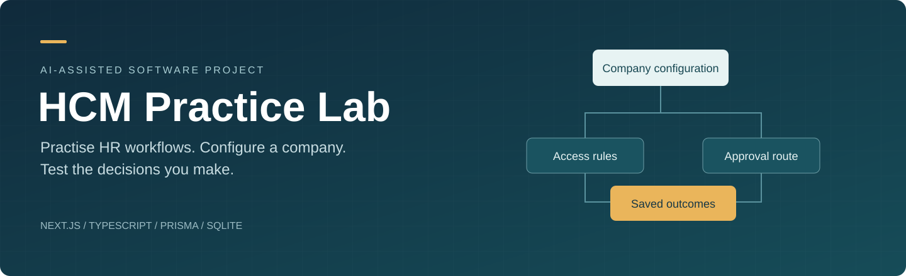
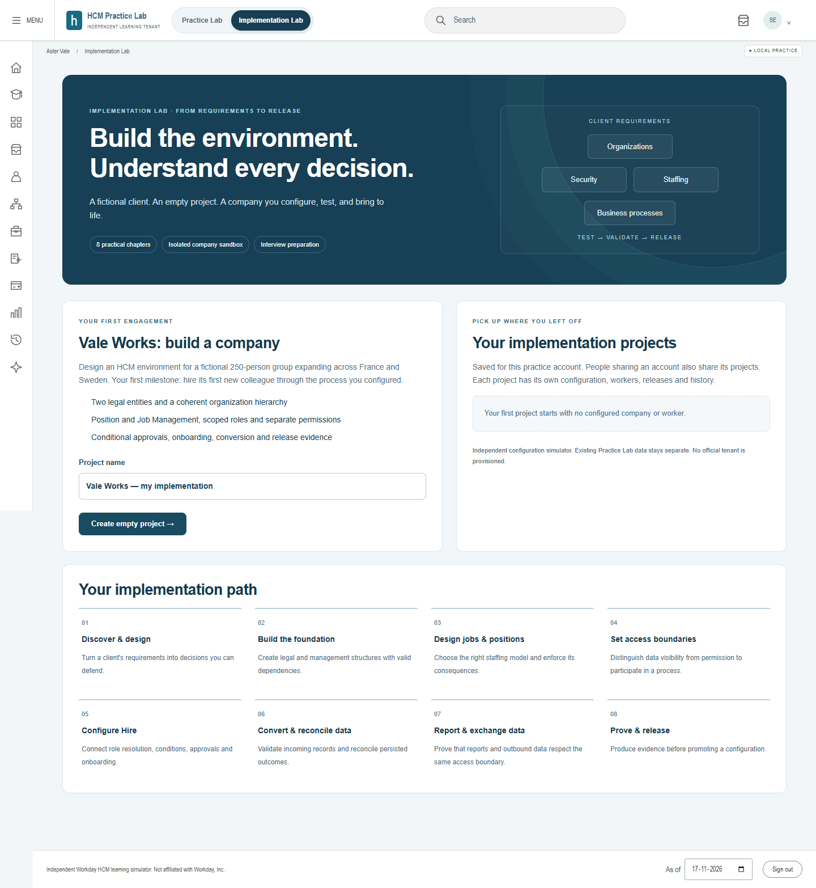
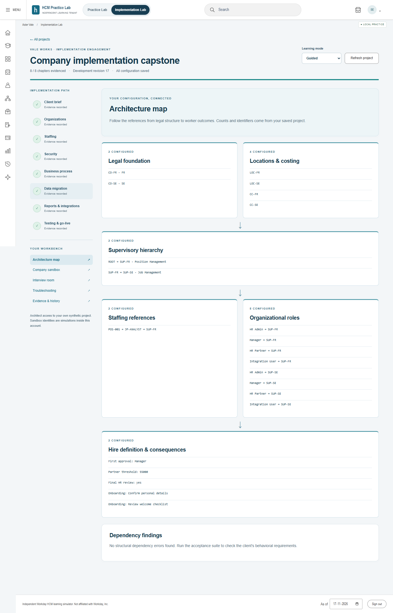

# HCM Practice Lab

A local HCM learning application with two ways to practise: work through HR transactions in a seeded company, or configure a company from an empty project and test the result.

The project began with a practical problem: a learner could watch training videos, but needed somewhere to make decisions and see what happened. HCM Practice Lab gives them fictional workers, approval tasks, configurable access rules, and a database that remembers their work.

Built with AI assistance through OpenAI Codex. The project owner defined the learning goals, supplied feedback, and directed the scope. Codex assisted with implementation, tests, debugging, and documentation. [Development approach](handbook/development.md)

**Development preview.** This is an independent simulator, not an official Workday tenant or training product. It uses original application code and synthetic data. It is not affiliated with Workday and does not claim feature parity or certification.

[Run locally](#run-locally) · [Try the walkthrough](handbook/walkthrough.md) · [Architecture](handbook/architecture.md) · [Security review](handbook/security-review.md) · [All documentation](handbook/README.md)

## What you can do

| Mode               | Work you can practise                                                                                           | What the application saves                                                                                   |
| ------------------ | --------------------------------------------------------------------------------------------------------------- | ------------------------------------------------------------------------------------------------------------ |
| Practice Lab       | Initiate a Hire, switch to the assigned approver, complete the process, inspect the worker and onboarding tasks | Transactions, approval history, worker changes, audit events                                                 |
| Academy            | Follow numbered lessons with highlighted controls, chapter progress, and saved resume points                    | Lesson progress and evidence from completed exercises                                                        |
| Implementation Lab | Configure companies, organization structure, staffing, access, and a conditional Hire route                     | Account-owned projects, configuration versions, sandbox transactions, acceptance evidence, release snapshots |

Practice Lab also includes recruiting, compensation, time off, benefits, and learning exercises. The Academy has eleven topics across five chapters. Finance, SCM, payroll, integrations, Studio, security, talent, and time tracking use reduced exercises with local outcomes; they are not complete enterprise modules.

Implementation Lab has eight chapters, from a client brief to a simulated production release. Its configuration affects behavior. A missing manager assignment can prevent a Hire from routing. A salary permission changes what a report can return. Approval creates the worker and onboarding tasks only when the required steps finish.



## Engineering decisions

- Authorization runs on the server. Data visibility, salary access, process participation, and organization scope are separate checks.
- A Hire snapshots its configuration at submission. Later edits do not silently change an approval already in progress.
- Database transactions keep completion effects together. Repeated request keys cannot create duplicate Hires.
- Implementation projects use version checks to reject stale writes. One learner's project data is excluded from the shared Practice Lab audit view.
- Completion depends on saved outcomes. Clicking through a tutorial does not satisfy the release checks.
- CSV imports validate the full batch before committing. Local exports apply scope and field permissions before serialization.

The [architecture guide](handbook/architecture.md) links these decisions to their source files and tests.

## Run locally

Use Node.js 24 and pnpm 11.25.0, the development baseline. Google Chrome is required for the configured browser tests. Package installation needs internet access; the running simulator needs no Workday account, API key, or external service.

```sh
git clone https://github.com/pseudofutur4-cmd/workdaysimul.git
cd workdaysimul
pnpm install --frozen-lockfile
```

Create the local environment file:

```powershell
# Windows PowerShell
Copy-Item .env.example .env
```

```sh
# macOS / Linux
cp .env.example .env
```

Initialize a new practice database and start the app:

```sh
pnpm db:migrate
pnpm db:seed
pnpm dev
```

Open [localhost:3000](http://127.0.0.1:3000). Choose HR Administrator (`hr`) and enter the demo password `Practice123!`. The account selector lists the other practice roles.

`db:seed` replaces practice data. Run it for a fresh installation, not each time you start the app. To return later, use `pnpm dev`. See [setup and operation](handbook/operations.md) for production builds, backups, and LAN access.

## A first session

1. Open Academy and choose People foundations, then Core HCM. Follow the guide through a Hire and switch practice accounts when instructed.
2. Use Implementation Lab in the header to create an empty project. Start with the client brief and record your design decisions.
3. Complete the foundation, staffing, and security chapters before testing the Hire in Company sandbox.
4. Inspect the architecture map and evidence. Use a troubleshooting copy to repair a missing role, excessive salary access, or a broken reference.

The [walkthrough](handbook/walkthrough.md) includes a reproducible two-company configuration, expected results, and interview discussion prompts.

<details>
<summary>View the configuration dependency map</summary>



</details>

## Verification and security

```sh
pnpm typecheck
pnpm test
pnpm test:e2e
pnpm build
pnpm audit
```

Service tests use `test.db`; browser tests use `e2e.db` and port 3001. They do not reset the working practice database. Test scope, dated results, and known limitations are recorded in [verification](handbook/verification.md).

The repository includes an application security review mapped to [OWASP Top 10:2025](https://top10.owasp.org/2025/) and a project-level risk and control review informed by [ISO/IEC 27001:2022](https://www.iso.org/standard/27001). Findings, fixes, evidence, and remaining risks are in the [security review](handbook/security-review.md). This is a self-assessment, not an independent penetration test, ISO certification, or a guarantee that no vulnerabilities remain.

The intended environment is a local machine or trusted practice network with synthetic data. Shared demo passwords, local HTTP support, and simulated personas make this unsuitable for public hosting or real employee records without further security work.

## Stack and source map

| Area                 | Implementation                          |
| -------------------- | --------------------------------------- |
| UI and server routes | Next.js App Router, React, TypeScript   |
| Validation and forms | Zod, React Hook Form                    |
| Persistence          | Prisma, SQLite, versioned migrations    |
| Interface            | Original CSS, Tailwind CSS              |
| Verification         | Vitest, Playwright, targeted axe checks |

```text
app/api/              Session, practice, academy, implementation, report routes
components/           Persistent app shell, tutorial and implementation views
lib/                  Workflow engines, access policy, validation, learning content
prisma/               Data model, migrations, synthetic seed
tests/                Service tests and browser journeys
handbook/             Public documentation and original app screenshots
```

## Scope and licensing

The simulator covers one implementation capstone, five sandbox identities, and sequential approval routes. Integrations create local CSV/JSON output. Test and Production are simulated configuration environments; they do not deploy to Workday or provision infrastructure. Interview prompts support reflection and do not grade professional correctness.

Original simulator code is available under the [MIT license](LICENSE). Workday trademarks and third-party materials are outside that license. Private reference documents, source images, extracted research, credentials, and databases are excluded from the repository. See [DISCLAIMER](DISCLAIMER), [third-party notices](THIRD_PARTY_NOTICES.md), and the [capability boundaries](handbook/scope.md).
