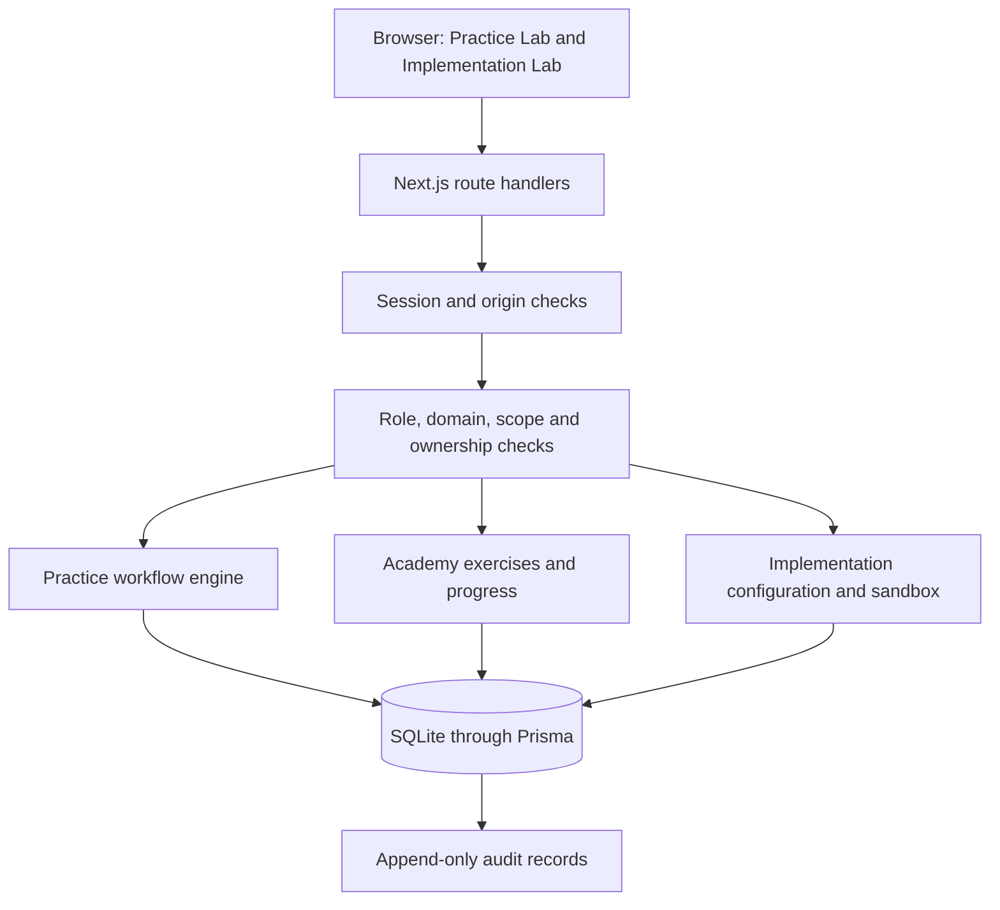
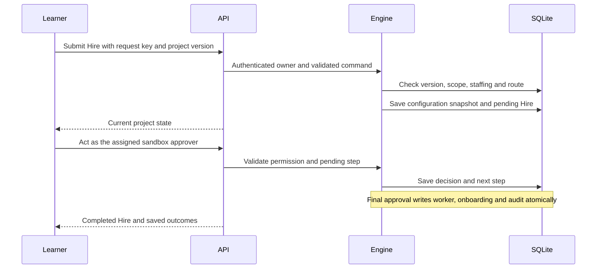

# Architecture

The app runs as one Next.js service with a local SQLite database. A persistent React shell handles page navigation and account state. API routes validate requests and call domain services; the services apply authorization and write through Prisma transactions.

## Data boundaries

Practice Lab has a seeded company dataset shared by practice accounts. Domain policies determine permitted actions, and account organization scope restricts the relevant data. Employee access is limited to the associated worker.

Implementation Lab stores each project under an account owner. Its configuration, releases, Hires, workers, and evidence are separate from Practice Lab employment records. A sandbox persona is a simulated identity selected by the project owner; it is not another authenticated account. The owner can inspect their project's synthetic data through the architect views.

The same SQLite file holds both modes. Isolation comes from server queries and ownership checks, not a separate database per learner. Sharing a login shares the ownership boundary.

## A sandbox Hire

The request key prevents duplicate submissions. Project versions reject writes based on stale state. Position and external ID constraints protect against duplicate workers or occupied seats. A denied or canceled Hire releases the pending reservation without creating a worker.

## Configuration and release evidence

Configuration is a validated JSON document containing foundation objects, assignments, policies, and process settings. `configurationFindings` checks references and hierarchy rules. Runtime outcomes have their own relational records.

Two hashes serve different purposes. The full configuration hash identifies acceptance and release evidence. The Hire configuration hash excludes discovery notes, report settings, and integration settings, so those edits do not invalidate a Hire that already proved the same staffing and approval behavior.

Promotion copies configuration to a Test or Production snapshot. It does not move workers between environments or deploy infrastructure. Restore copies a snapshot back into Development and preserves runtime records; reference checks prevent edits that would orphan them.

## Security boundaries

Session tokens are random opaque values; only their SHA-256 digests are stored. Passwords use scrypt with per-password salts. The local demo retains compatibility with legacy hashes and upgrades them on a successful login.

Mutation routes check request origin and browser fetch metadata. Domain and ownership checks run again in the services. Report projections filter scope, effective dates, and protected salary fields before returning data. SQL triggers prevent application-level updates and deletes of audit events. Someone who controls the database file can still alter or replace it; the audit is not an externally anchored tamper-proof ledger.

See the [security review](security-review.md) for the local-demo threat model and residual risks.

## Source map

| Responsibility                              | Source                                                                    |
| ------------------------------------------- | ------------------------------------------------------------------------- |
| Persistent UI and account navigation        | [`components/Lab.tsx`](../components/Lab.tsx)                             |
| Implementation views and coaching           | [`components/ImplementationLab.tsx`](../components/ImplementationLab.tsx) |
| Practice process transitions                | [`lib/engine.ts`](../lib/engine.ts)                                       |
| Practice access decisions                   | [`lib/policy.ts`](../lib/policy.ts), [`lib/read.ts`](../lib/read.ts)      |
| Implementation commands and validation      | [`lib/implementation-engine.ts`](../lib/implementation-engine.ts)         |
| Configuration schemas and learning chapters | [`lib/implementation-catalog.ts`](../lib/implementation-catalog.ts)       |
| Academy exercises                           | [`lib/academy-engine.ts`](../lib/academy-engine.ts)                       |
| Sessions and passwords                      | [`lib/auth.ts`](../lib/auth.ts), [`lib/password.ts`](../lib/password.ts)  |
| Data model                                  | [`prisma/schema.prisma`](../prisma/schema.prisma)                         |
| API boundary                                | [`app/api`](../app/api)                                                   |

## Tradeoffs

SQLite keeps setup small and makes offline practice practical. It also means the app depends on one host and is not designed for high write concurrency or horizontal scaling. A shared password and selectable demo accounts help learners practise approval handoffs, but they do not establish separate personal identities.

The configuration model supports a fixed set of roles and sequential approval steps. That makes failures explainable within one capstone. General process graphs, inherited organization security, and external integration transports would require additional models and tests.

The large React views and central workflow engines keep the current behavior easy to locate, but they will become harder to maintain as more scenarios are added. Splitting them by domain is a sensible follow-up once interfaces between those domains are stable.
