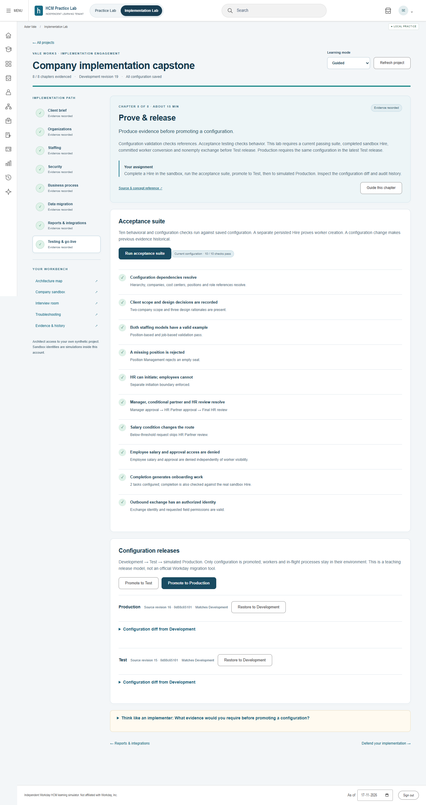

# Learning walkthrough

## Try a Hire in Practice Lab

Sign in as HR Administrator and open Academy. Choose People foundations, then Core HCM. The guide opens the task and marks the relevant control. Use the numbered instructions to choose a pre-hire and an available position, then submit.

Open My Tasks to inspect the event. Switch to the assigned Manager account when the guide asks you to approve it. Return to HR for final review if the configured route requires it. After completion, find the worker and review the onboarding tasks and audit history.

The useful question at each step is what changed in the saved data. Before final approval, a pending Hire reserves a position. Completion produces employment records and onboarding consequences. A denied or canceled transaction should not produce a completed worker.

Pause the guide to explore the page. Resume lesson returns to its saved checkpoint. A saved checkpoint and a completed exercise are separate: the application checks the underlying transaction before recording success.

## Configure a company in Implementation Lab

Select Implementation Lab in the header and create an empty project. Work through the chapters in order. Save each set of objects before using their references elsewhere. Use Guide this chapter for instructions, or work independently and check the evidence afterward.

| Chapter                     | Work to complete                                                                    | Result to inspect                                        |
| --------------------------- | ----------------------------------------------------------------------------------- | -------------------------------------------------------- |
| 1. Discover & design        | Read the two-company brief; record organization, security, and acceptance decisions | Saved design rationale                                   |
| 2. Build the foundation     | Create companies, locations, cost centers, and a supervisory hierarchy              | Valid references and one root organization               |
| 3. Design jobs & positions  | Add a job profile and a seat for Position Management                                | An available position linked to the correct organization |
| 4. Set access boundaries    | Assign personas to organizations; set data and process grants separately            | Scoped access and denied employee salary access          |
| 5. Configure Hire           | Set approval role, conditional partner review, final review, and onboarding tasks   | Resolvable route and a completed sandbox Hire            |
| 6. Convert & reconcile data | Map the sample CSV, inspect validation, and commit valid rows                       | Saved workers matching the accepted input                |
| 7. Report & exchange data   | Compare report identities and run a local outbound exchange                         | Scoped report and a nonempty exchange result             |
| 8. Prove & release          | Run acceptance checks, release to Test, then simulated Production                   | Current configuration evidence and release snapshots     |

## Reproducible example

These values match the original automated [test fixture](../tests/implementation-fixture.ts). They are fictional and make the built-in sample conversion easy to reproduce.

| Object             | Reference    | Configuration                                                        |
| ------------------ | ------------ | -------------------------------------------------------------------- |
| Company            | `CO-FR`      | Vale Works France; FR; EUR                                           |
| Company            | `CO-SE`      | Vale Works Sweden; SE; SEK                                           |
| Location           | `LOC-FR`     | Paris Office; FR                                                     |
| Location           | `LOC-SE`     | Stockholm Office; SE                                                 |
| Cost center        | `CC-FR`      | France Operations; company `CO-FR`                                   |
| Cost center        | `CC-SE`      | Sweden Operations; company `CO-SE`                                   |
| Root organization  | `SUP-FR`     | France Operations; `CO-FR`; `CC-FR`; Position Management             |
| Child organization | `SUP-SE`     | Sweden Operations; parent `SUP-FR`; `CO-SE`; `CC-SE`; Job Management |
| Job profile        | `JP-ANALYST` | Operations Analyst; Operations family                                |
| Position           | `POS-001`    | First analyst seat; `SUP-FR`; `JP-ANALYST`; `LOC-FR`                 |

Assign HR Admin, Manager, HR Partner, and Integration User to the organizations used in the exercise. Grant worker visibility to those four roles. Grant salary visibility and Hire initiation to HR Admin. Grant Hire approval to HR Admin, Manager, and HR Partner. Keep Employee salary and approval permissions denied. Scope does not inherit through the hierarchy; assignments must be explicit.

Choose Manager as first approver, a partner threshold of 55,000, and final HR review. Add two onboarding tasks, such as Confirm personal details and Review welcome checklist. These are simulator settings, not an official deployment recommendation.

In Company sandbox, submit a Development Hire as HR Admin with a new external ID, `SUP-FR`, `JP-ANALYST`, `LOC-FR`, `POS-001`, and salary 60,000. Choose a valid effective date and use that date or later when reporting. Follow the pending approvals as Manager, HR Partner, and HR Admin. Inspect the created worker and complete an onboarding task.

Use the provided sample worker CSV in Data migration. Its references require `SUP-SE`, `JP-ANALYST`, and `LOC-SE`. Preview once with an incorrect organization reference to observe rejection, then restore the valid input and commit. Verify the saved rows before moving on.

Enable the local exchange without salary fields and run it with the Integration User's worker grants. Return to Testing & go-live and run the acceptance suite. Test release requires current passing checks, a compatible completed Development Hire, converted workers, and a nonempty current Development exchange. Production also requires the latest Test snapshot to match the current configuration. Editing configuration can make earlier evidence out of date.

## Practise explaining the decisions

Open the architecture map to trace dependencies. Explain why a cost center and supervisory organization are separate, why a visible worker does not imply approval permission, and why a transaction keeps its submitted configuration.

Troubleshooting creates a separate copy with one fault: missing routing assignment, excessive employee salary access, or a broken cost-center reference. Diagnose the failure, change the configuration, and rerun the checks. The baseline project stays intact.

Interview mode saves written responses to eight prompts. Its coverage indicator measures completion of responses, not the quality or professional correctness of the explanation. Review the answers with a knowledgeable person before using them as interview preparation.
